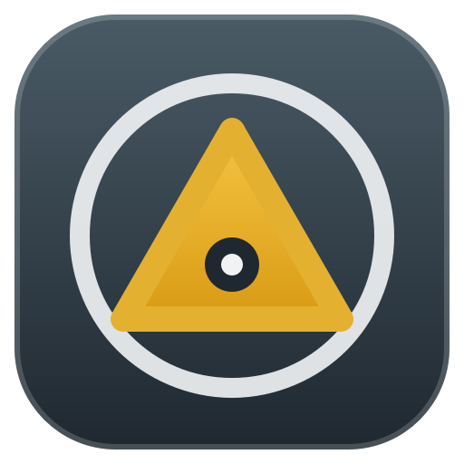
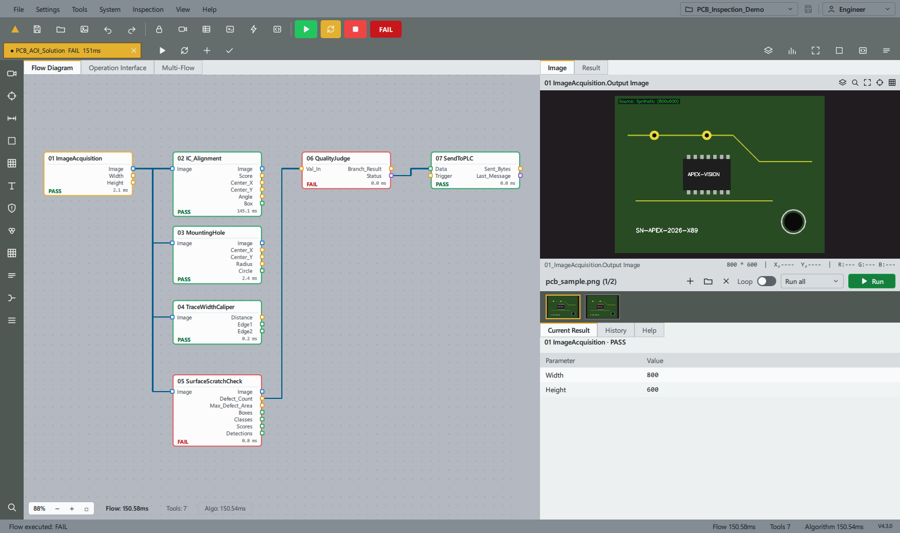
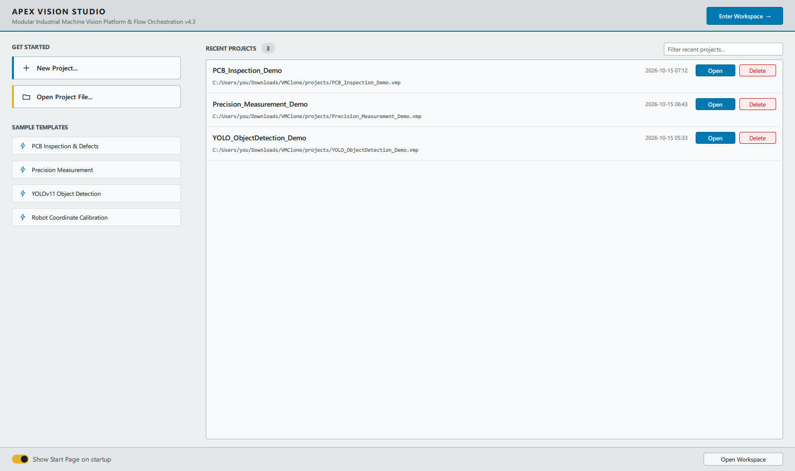
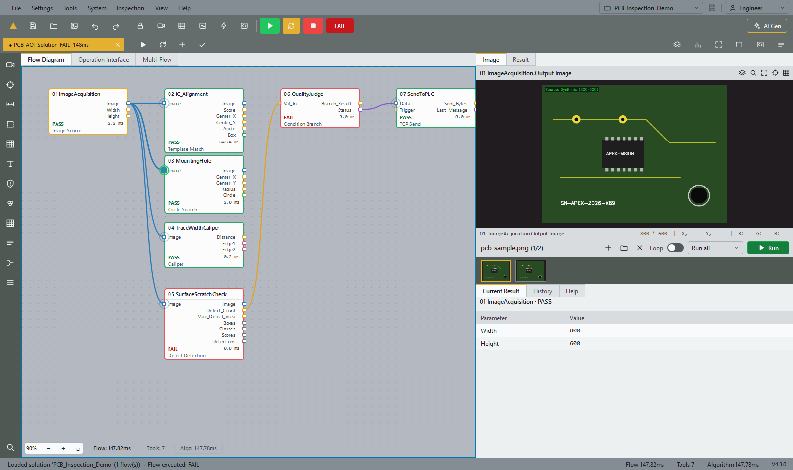
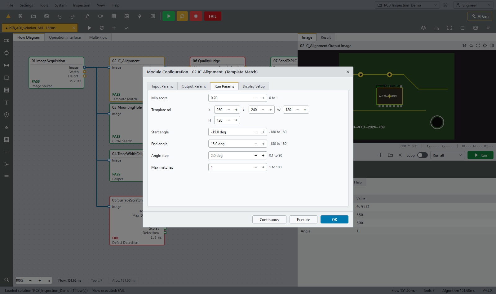
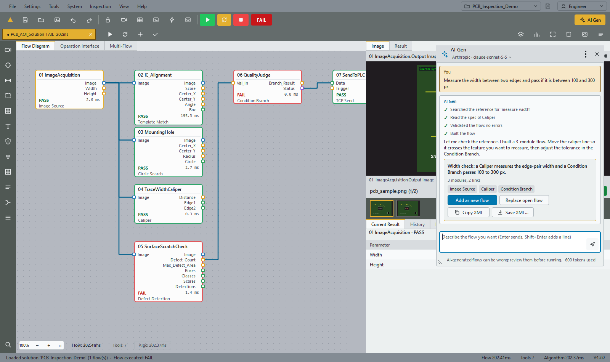
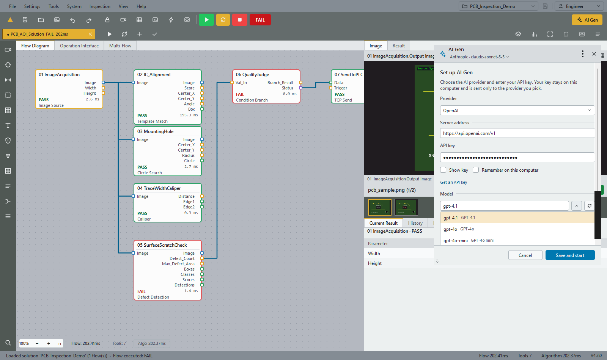
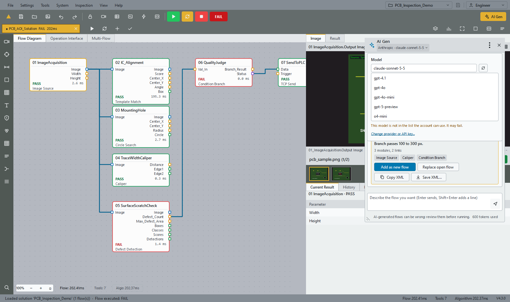

<p align="center"></p>

<h1 align="center">Apex Industrial Vision Studio</h1>

<p align="center">
Build machine-vision inspections by wiring blocks together, or just describe the inspection and let an AI assistant wire them for you.
</p>

<p align="center">
<a href="LICENSE"></a>


</p>



## What is this?

Apex Vision Studio is a desktop app for designing automated optical inspections: check a PCB for scratches, measure a width
to the pixel, read a serial number, count parts on a tray, send a pass/fail to a PLC. You build each inspection as a **flow**
of small modules (acquire an image, find a feature, measure it, judge the result) and press Run. Nothing to compile, no
script to write unless you want one.

It is written in Python with Qt Quick, OpenCV and NumPy. It runs on Windows, Linux and macOS, talks to Hikrobot industrial
cameras, and works fine with no camera at all (there are synthetic test images and image folders for that).

## A quick tour

**Start with a template or an empty flow.** The start page offers sample solutions (PCB inspection, precision measurement,
YOLO object detection, robot calibration) and remembers your recent projects.



**Wire modules together.** Drag from an output port to an input port. Wires are curves coloured by data type. While you
drag, the ports that can take the wire light up and the nearest one snaps. You can also pick a wire up by its end, link
backwards from an input, or drop on a module's body to let it choose the port.



**Tune each module with the right control.** Fixed choices are drop-downs, on/off settings are switches, numbers have limits
and units, regions are X/Y/W/H fields. Every module also shows which toolbox entry it is, so a card called "MountingHole"
tells you it is a *Circle Search*. Modules can be renamed (F2).



**Or ask AI Gen to build it.** Press <kbd>Ctrl</kbd>+<kbd>G</kbd>, say what you want ("measure the width between two edges
and pass if it is 100 to 300 px"), and the assistant looks up the module reference, drafts a flow, checks it, and offers it
to you. Nothing is added until you click **Add as new flow**, and Ctrl+Z takes it back.



AI Gen uses **your own API key**. Pick a provider and a model once (Claude, OpenAI, Gemini, Mistral, DeepSeek, xAI, Groq,
OpenRouter, or a local Ollama / LM Studio model); the model list loads from your account, and you can switch model from the
chat's title bar at any time. Details, privacy notes and the MCP server are in [docs/AI_GEN.md](docs/AI_GEN.md).

<p align="center">


</p>

## What you can do with it

- **Design flows visually.** 42 built-in modules in 11 categories: acquisition, location (template match, circle / line
  search, caliper), measurement, image processing, recognition (barcode, OCR, YOLO), defect detection, colour, calibration,
  communication and logic. Typed ports, no loops, one source per input.
- **Run on real or fake images.** Single shot, or loop over a folder of images; the Run button turns into Stop while it works.
  Flows run on a background worker, so the window stays responsive.
- **See results at a glance.** Per-module PASS/FAIL, timings, overlays on the image, and a table of every module's outputs.
- **Evaluate detectors.** Load a labelled dataset, get precision / recall / F1 / AP, browse false positives and negatives, and
  compare experiments.
- **Calibrate cameras.** A lens-distortion wizard (chessboard, circle grids) and N-point pixel-to-world calibration.
- **Save everything as plain files.** Projects are `.vmp` (JSON) or readable **XML**; see [docs/XML_FORMAT.md](docs/XML_FORMAT.md).
- **Extend it.** Drop a plugin into `plugins/` to add your own modules ([docs/PLUGIN_DEVELOPMENT_GUIDE.md](docs/PLUGIN_DEVELOPMENT_GUIDE.md)).

## Install and run

**Windows users:** grab the installer or the portable ZIP from [Releases](https://github.com/kwincheah/vision-studio/releases)
and run `ApexVisionStudio.exe`. No Python needed.

**From source** (Python 3.10 or newer):

```bash
git clone https://github.com/kwincheah/vision-studio.git
cd vision-studio
python -m venv .venv
.venv\Scripts\activate          # Linux / macOS: source .venv/bin/activate
pip install -r requirements.txt
python main.py
```

Useful variations:

```bash
python main.py my_solution.vmp     # open a project directly
python main.py --widgets           # the older widget-based interface
python main.py --mcp               # run the flow-generation tools as an MCP server
```

Optional extras: `pip install ultralytics` for the YOLO module, `pip install rapidocr-onnxruntime` for OCR.

## Handy shortcuts

| | |
|---|---|
| **Ctrl+N / O / S** | new / open / save a solution |
| **Ctrl+G** | open AI Gen |
| **Ctrl+Z / Y** | undo / redo (moves, links, parameter edits, renames, AI-built flows) |
| **Arrows, Shift+Arrows** | on the canvas: select the neighbouring module / move it |
| **Enter, F2** | configure / rename the selected module |
| **L** then arrows, Enter | link the selected module to another from the keyboard |
| **K, Delete** | select the next link / delete the selected module or link |
| **+ / -, Home** | zoom and fit |

The whole flow canvas can be used without a mouse. Help > Keyboard Shortcuts lists everything.

## For developers

```text
main.py                 entry point (Qt Quick UI by default)
qml/                    the interface; open qml/ApexVision.qmlproject in Qt Design Studio
apex_vision/core/          flow engine, project files, shared run controller
apex_vision/tools/         the 42 built-in modules
apex_vision/flowgen/       AI Gen: module catalogue, spec validator, assistant, MCP server, reference docs
apex_vision/ui/            the older widget interface
plugins/                sample plugin
projects/               sample solutions
tests/                  pytest suite (1,300+ tests)
docs/                   guides and specs
```

Run the tests and the secret scan:

```bash
pip install -r requirements-dev.txt
python -m pytest tests/        # a full run takes a while: many tests drive the real window with mouse and keyboard
python scripts/check_secrets.py
```

The UI tests operate the actual QML window with real mouse and keyboard events (dragging wires, typing into fields,
opening menus) and fail on any Qt warning, so what you see in the screenshots is what the tests drive.

More reading:
[AI Gen](docs/AI_GEN.md) ·
[Parameter editors](docs/PARAMETER_EDITORS.md) ·
[XML format](docs/XML_FORMAT.md) ·
[QML conversion notes](docs/QML_CONVERSION.md) ·
[Plugin guide](docs/PLUGIN_DEVELOPMENT_GUIDE.md) ·
[Release notes](docs/RELEASE_NOTES_v4.3.0.md)

### Building the Windows app

```bash
pyinstaller ApexVisionStudio.spec --clean --noconfirm     # dist/ApexVisionStudio/
iscc installer_setup.iss                                  # installer (needs Inno Setup 6)
```

## Good to know

- AI-generated flows can be wrong. Check regions and thresholds against your own images before running a line with them.
- Only your messages, the lookups the assistant makes and the flow it is working on go to the AI provider; images never do.
  API keys stay on your machine (optionally in the Windows Credential Manager / Keychain) and never enter project files.
- The look is a light industrial theme. Product names and manuals mentioned belong to their owners.

## License

MIT, see [LICENSE](LICENSE). Contributions and bug reports are welcome; there are issue and pull-request templates in
`.github/`.
